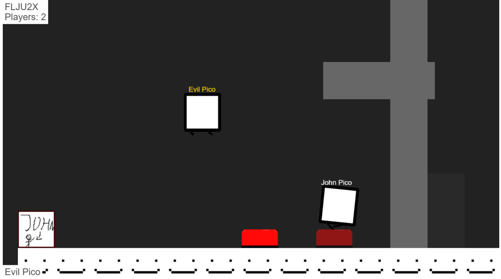

<div align="center">

# Web Park



### An online multiplayer co-op game inspired by pico park

### Currently, in early development

$\color{gray} \text{now without pico park sprites! revolutionary stuff}$

---

</div>

<br>

## Current features

- Lobby system with joining using a code, data check, waiting for everyone to ready up, and lobby info display
- ~~Custom player colors~~ _(currently broken)_, custom names
- Basic sound effects
- Game synchronization
- Movement and Physics
- ~~Different sprites for different actions~~ Procedural animated player!
- _Less_ basic main menu
- Basic and not-so basic Entities (Buttons, Doors, Moving Platforms, Lasers, _everyone's favorite JohnEntity_ and more) with many options
- Level loading from LDtk
- Camera system that keeps all players on screen at once
- Basic Hud/Ui
- ART DIRECTION _~~but no final art yet~~_

## Planned features
- Maybe even more entities? _...probably even more entities_
- Level changing _(no clue how we keep forgetting about this ngl)_
- Better feeling movement
- Drawing on the player cube to make your own face/mouth
- More procedural animation because it's peak

<br>

## How it was made

### The people:

The game is being developed by 2 people

- Pysia20 : all Frontend / client side stuff, so rendering, sending inputs, animations, menus, CSS etc. and in the future art
- LLoydowski: all Backend / server side stuff, so physics, networking, server set up, entities/objects etc.

We are designing the game together

<br>

### What we used:

Core :

- TypeScript as the main language
- pnpm workspaces for separating server, client and shared
- LDtk for level creation _(great tool ngl)_

Frontend :

- Vanilla HTML and CSS for the websites
- WebStorm for coding _(also the thing you are reading right now)_
- GIMP for making images
- Audacity for a _very lil bit_ of audio editing
- PixiJS for rendering
- Socket.io Client for communicating with the server
- Howler.js for audio

Backend:

- Node.js with tsx as runtime
- Express.js for HTTP API
- Socket.io for player synchronization, live updates
- Zod for data validation
- Nginx to merge frontend and backend, proxies
- Pino for logging
- Visual Studio Code for coding

<br>

## How to edit or run the project

If you don't have pnpm it's technically not required, **but** we **highly** recommend installing it since that's what the project was and this guide made on

Firstly download all the files and open them in your IDE, then run this command to install all the dependencies

```bash
pnpm install
```

Then to launch the server:

```bash
pnpm --filter server dev
```

And the client:

```bash
pnpm --filter client dev
```

You also need to uncomment the proxy in client/vite.config.ts to allow the client to connect to the server (unless you know how to use nginx)

And now everything _~~should~~_ work!

<br>

## AI Disclosure

Since most of the tools here are entirely new to us, AI was used to help with learning and exploring them (ex. how to show a sprite using Pixi, how to play a sound effect with howler etc.), general coding help (ex. how to use grid in CSS, how to tint an image in CSS) and quite a lot of pure math in Player.ts since I didn't feel like reinventing inverse kinematics
